# MolecuLab — Complete Technical Architecture & Developer Manual
**Document Standard:** docs-architect Specification Version 1.0  
**Target Audience:** Scientific Software Architects, Computational Chemists, Julia Developers, QA & Release Engineers  
**Software Version:** 1.0.0 (Validated on Julia 1.10–1.13, Windows 11 x86_64)  
**Repository:** [`ZengLLQ/molecul-lab`](https://github.com/ZengLLQ/molecul-lab)  

---

## Table of Contents
1. [Executive Summary](#1-executive-summary)
2. [System Vision & Architectural Principles](#2-system-vision--architectural-principles)
3. [Architecture Overview & System Topology](#3-architecture-overview--system-topology)
4. [Design Decisions & Trade-Off Analysis](#4-design-decisions--trade-off-analysis)
5. [Core Components Deep Dive](#5-core-components-deep-dive)
   - 5.1 Presentation Layer (`MolecuLab.UI`, `MolecuLab.App`)
   - 5.2 Application Services (`MolecuLab.Application`)
   - 5.3 Domain Model (`MolecuLab.Domain`)
   - 5.4 Computational Core (`MolecuLab.Chemistry`)
   - 5.5 Simulation & Numerical Optimization (`MolecuLab.Simulation`)
   - 5.6 Storage & Persistence (`MolecuLab.Storage`, `MolecuLab.IO`)
   - 5.7 Diagnostics & Telemetry-Free Introspection (`MolecuLab.Diagnostics`)
6. [Data Models & Schema Architecture](#6-data-models--schema-architecture)
7. [Computational Pipeline & Mathematical Linkage](#7-computational-pipeline--mathematical-linkage)
8. [Asynchronous Execution & Cooperative Cancellation](#8-asynchronous-execution--cooperative-cancellation)
9. [Deployment, Local Environment & Portability](#9-deployment-local-environment--portability)
10. [Performance Characteristics & Scaling](#10-performance-characteristics--scaling)
11. [Security, Privacy & Sandboxing Architecture](#11-security-privacy--sandboxing-architecture)
12. [Troubleshooting, Edge Cases & Failure Modes](#12-troubleshooting-edge-cases--failure-modes)
13. [Reading Paths & Onboarding Guide](#13-reading-paths--onboarding-guide)

---

## 1. Executive Summary

**MolecuLab** is an open-source, desktop computational chemistry workbench engineered entirely in **Julia**. Designed from first principles to be local-first, reproducible, and scientifically honest, MolecuLab bridges the gap between interactive exploratory molecular modeling and high-rigor numerical batch computation.

Unlike web-based molecular viewers or cloud-dependent SaaS chemistry tools, MolecuLab runs **100% locally** on the user's workstation. Project metadata is persisted in an embedded SQLite database, atomic coordinate snapshots and trajectory checkpoints are managed in atomic content-hashed files, and heavy simulation tasks execute in asynchronous worker threads decoupled from the desktop user interface.

### Key Capabilities in v1.0.0
- **3D Interactive Molecular Canvas:** Native Gtk4 window with custom Cairo 3D vector-rendered molecular viewport featuring depth sorting, trackball rotation, zoom, pan, and real-time atom picking.
- **Chemoinformatic Ingestion & Validation:** Comprehensive parsers for `.xyz`, `.mol`/`.sdf`, and `.pdb` formats; structural sanitization enforcing valence bounds, coordinate finiteness, and zero-distance singularity prevention.
- **Reference Molecular Mechanics:** 12-6 Lennard-Jones pair potential with analytical gradients and singularity-repulsion damping, integrated with `Optim.jl` (BFGS, L-BFGS, CG, Gradient Descent).
- **Symplectic Molecular Dynamics:** Velocity-Verlet $NVE$ microcanonical integrator with Maxwell-Boltzmann velocity initialization, center-of-mass momentum correction, and $\mathcal{O}(\Delta t^2)$ energy conservation guarantees.
- **End-to-End Reproducibility:** Every experiment generates an immutable manifest recording exact inputs, algorithmic hyperparameters, Julia runtime version, package hashes, CPU/GPU hardware details, and output artifact checksums.

---

## 2. System Vision & Architectural Principles

MolecuLab adheres to ten immutable architectural principles:

| Principle | Engineering Standard |
|---|---|
| **1. Julia-First** | Domain models, computational kernels, UI bindings, and application orchestration are written in pure Julia. |
| **2. Local-First** | All project data, configurations, logs, and artifacts are stored on the local disk. Zero network requests, zero cloud accounts, zero telemetry. |
| **3. Scientific Honesty** | No claims of drug discovery affinity, clinical toxicity, or quantum accuracy without validated benchmarks. Descriptors are strictly labeled topological or physical. |
| **4. Reproducibility** | Experiments reference immutable coordinate snapshots and record full runtime hardware/software provenance manifests. |
| **5. Responsive UI** | Calculations run on asynchronous `Base.Threads.@spawn` workers. The Gtk event loop is never blocked. |
| **6. Truthful States** | Never display "converged", "100%", or "GPU active" unless verified by solver status and hardware sensors. |
| **7. Clean Modular Monolith** | Single Julia package with strict horizontal layering: UI $\to$ Application Services $\to$ Domain & Comp Core $\to$ Storage Adapters. |
| **8. Memory Safety & Safeguards** | All geometric divisions and trigonometric operations enforce singularity clamping ($\varepsilon \ge 10^{-12}$) to prevent `NaN` and `Inf` pollution. |
| **9. Cooperative Cancellation** | Long-running simulation tasks query atomic cancellation tokens at every step and unwind gracefully. |
| **10. Zero Hallucination** | Mathematical implementations strictly match analytical expressions documented in [`docs/SCIENTIFIC_METHODS.md`](file:///f:/MoleculLab/docs/SCIENTIFIC_METHODS.md) and [`docs/MATHEMATICAL_SPECIFICATIONS.md`](file:///f:/MoleculLab/docs/MATHEMATICAL_SPECIFICATIONS.md). |

---

## 3. Architecture Overview & System Topology

The system is organized as a layered modular monolith following Hexagonal (Ports & Adapters) boundaries:

```
+-------------------------------------------------------------------------+
|                           PRESENTATION LAYER                            |
|  - Main Desktop Shell (Gtk4 Window, Dark Theme, HeaderBar, Paned Split)  |
|  - Project Explorer View (Tree navigation, project creation)            |
|  - 3D Molecular Viewport (Cairo 3D projection, depth sort, atom picking) |
|  - Experiment Configurator & Launch Panel (Algorithm selector, params)  |
|  - Real-Time Results & Convergence Dashboard (Energy & trajectory plots) |
|  - Diagnostics & Hardware Telemetry Panel (CPU, RAM, GPU status)        |
+-------------------------------------------------------------------------+
                                     |
                                     | Dispatches commands / queries
                                     v
+-------------------------------------------------------------------------+
|                       APPLICATION SERVICES LAYER                        |
|  - ProjectService: Project lifecycle, manifest synchronization          |
|  - StructureService: File ingestion, validation, snapshotting           |
|  - ExperimentService: Configuration validation, worker dispatch         |
+-------------------------------------------------------------------------+
                   |                                    |
                   | Domain operations                  | Math & Kernels
                   v                                    v
+--------------------------------------+ +--------------------------------+
|             DOMAIN MODEL             | |       COMPUTATIONAL CORE       |
|  - Project (UUID, Name, Root, Times) | |  - Geometry (Distance, Angle,  |
|  - Molecule & Structure (Atoms, Bonds| |    Dihedral, COM, Rg, Box)     |
|  - Experiment (Config, Method, Hash) | |  - Descriptors (Formula, MW,   |
|  - Job (State Machine, Timers, Seed) | |    Heavy Atoms, Valence)       |
|  - Result & Artifact (Logs, Traces)  | |  - Validation Rules Engine     |
+--------------------------------------+ +--------------------------------+
                   |                                    |
                   +-----------------+------------------+
                                     |
                                     | Drives adapters
                                     v
+-------------------------------------------------------------------------+
|                      SIMULATION & ADAPTER LAYER                         |
|  - AbstractChemistryMethod Interface: method_id, validate, execute      |
|  - MolecularMechanics: LJ 12-6 analytical energy, gradient, Optim.jl    |
|  - MolecularDynamics: Velocity-Verlet symplectic NVE integrator         |
|  - Future Extensible Adapters: Molly.jl, DFTK.jl                        |
+-------------------------------------------------------------------------+
                                     |
                                     | Persists state & artifacts
                                     v
+-------------------------------------------------------------------------+
|                      INFRASTRUCTURE & PERSISTENCE                       |
|  - SQLite.jl: Embedded relational schema for metadata indexing          |
|  - Atomic Filesystem Storage: Snapshot files, results.json, logs        |
|  - File Importers & Exporters: XYZ, SDF/MOL, PDB formats                |
|  - Hardware Introspection: SysInfo, nvidia-smi / CUDA runtime detection |
+-------------------------------------------------------------------------+
```

### Component Interaction Sequence

```
User               UI Event Loop          ExperimentService           Worker Thread             SQLite / Disk
 |                       |                       |                          |                         |
 |--- Click "Run" ------>|                       |                          |                         |
 |                       |--- submit_job() ----->|                          |                         |
 |                       |                       |--- validate_config() --->|                         |
 |                       |                       |--- create_job(queued) ---------------------------->|
 |                       |                       |--- write_snapshot() ------------------------------>|
 |                       |                       |--- @spawn worker ------->|                         |
 |                       |<-- return Job --------|                          |                         |
 |                       |                                                  |--- set state(running) ->|
 |                       |                                                  |--- compute step 1..K ---|
 |                       |                                                  |-- progress callback --->|
 |                       |<-- progress update ------------------------------|                         |
 |<-- Update canvas -----|                                                  |                         |
 |                       |                                                  |--- verify convergence --|
 |                       |                                                  |--- write artifacts ---->|
 |                       |                                                  |--- set state(completed)|
 |                       |<-- completion event -----------------------------|                         |
 |<-- Render results ----|                       |                          |                         |
```

---

## 4. Design Decisions & Trade-Off Analysis

### Decision 1: Pure Julia Modular Monolith vs. Python/Electron Split
- **Context:** Many modern desktop apps wrap Python computational backends with Electron/TypeScript or Python GUI frameworks (PyQt).
- **Decision:** Build MolecuLab entirely in Julia with Gtk4.jl and native Cairo vector rendering.
- **Rationale:** Prevents multi-language dependency sprawl, eliminates cross-process IPC serialization overhead, enables seamless JIT-compilation of computational kernels, and guarantees that domain models are directly usable in both desktop GUI and headless Julia scripts.

### Decision 2: Hybrid Persistence (Relational SQLite + Immutable Filesystem)
- **Context:** Choosing between storing all data inside a single SQLite database vs. pure flat files.
- **Decision:** SQLite stores relational metadata (projects, molecule records, experiment configurations, job states); the filesystem stores atomic coordinate snapshots, execution logs, and trajectory arrays.
- **Rationale:** Storing multi-megabyte trajectory checkpoints and raw logs as SQLite BLOBs causes database bloat and lock contention during concurrent worker writes. Flat files with content hashes guarantee immutability and allow users to inspect results with standard UNIX tools.

### Decision 3: Gtk4 Canvas with Software Cairo 3D vs. Heavy OpenGL Window
- **Context:** Rendering 3D molecules with an OpenGL context vs. Cairo vector graphics.
- **Decision:** Implement a custom 3D trackball and depth-sorted projection engine in Cairo on top of `GtkCanvas`.
- **Rationale:** Gtk4's OpenGL area bindings on Windows frequently suffer from driver-dependent context creation crashes, Wayland/X11 quirks on Linux, and complex C-library binding issues. Cairo software rasterization provides 100% deterministic, crash-free vector drawing with atom picking across all Windows and Linux desktop environments with zero external shader compilation.

### Decision 4: Cooperative Cancellation via `Atomic{Bool}`
- **Context:** How to stop a running optimization or MD simulation without corrupting memory or terminating the Julia host process.
- **Decision:** Pass an atomic boolean token (`Base.Threads.Atomic{Bool}`) to every simulation method. Optimizers and integrators poll this token at the end of every iteration.
- **Rationale:** Forcibly killing an OS thread in Julia can cause undefined memory state, unreleased file locks, or orphaned SQLite transactions. Cooperative checking guarantees that workers finish their current cycle, flush intermediate diagnostics to disk, transition the job state cleanly to `cancelled`, and release all locks.

---

## 5. Core Components Deep Dive

### 5.1 Presentation Layer
Located in: [`src/ui/`](file:///f:/MoleculLab/src/ui/) and [`src/app/`](file:///f:/MoleculLab/src/app/)
- **Main Window (`src/app/window.jl`):** Instantiates the top-level `GtkApplicationWindow` (1280x860 default size), injects custom modern dark CSS styling, and organizes the interface into a two-column responsive split via `GtkPaned`.
- **3D Molecular Viewport (`src/ui/molecular_view.jl`):**
  - Uses `GtkCanvas` with mouse motion and click controllers.
  - Implements quaternion-based trackball rotation, zoom scaling, and translation panning.
  - Implements orthographic 3D-to-2D perspective projection with z-depth sorting (`sortperm(depths, rev=true)`).
  - Implements Euclidean ray-sphere hit testing for atom picking, highlighting selected atoms with dual outer halos.
- **Panels:**
  - `ProjectView` (`src/ui/project_view.jl`): Tree view of projects, active molecule selector, and metadata display.
  - `ExperimentView` (`src/ui/experiment_view.jl`): Tabbed configuration view for Geometry Optimization vs. Molecular Dynamics.
  - `ResultsView` (`src/ui/results_view.jl`): Convergence history table, energy delta metrics, and playback controls.
  - `DiagnosticsView` (`src/ui/diagnostics_view.jl`): Hardware monitor displaying CPU threads, RAM utilization, and GPU status.

### 5.2 Application Services Layer
Located in: [`src/application/`](file:///f:/MoleculLab/src/application/)
- **`ProjectService` (`src/application/project_service.jl`):**
  - Manages project directory creation, SQLite database initialization, and active project session state.
- **`StructureService` (`src/application/structure_service.jl`):**
  - Wraps file parsers, validates chemical structures against domain rules, and writes immutable snapshots into `structures/snapshots/<hash>.json`.
- **`ExperimentService` (`src/application/experiment_service.jl`):**
  - Pre-validates simulation parameters using `SimulationInterface.validate_method_config`.
  - Spawns asynchronous simulation jobs via `Base.Threads.@spawn`.
  - Manages job state transitions, progress telemetry, and post-run artifact persistence.

### 5.3 Domain Model
Located in: [`src/domain/`](file:///f:/MoleculLab/src/domain/)
- **`Structures` (`src/domain/structures.jl`):** Defines `Atom` (with index, symbol, atomic number, Cartesian coordinates $x, y, z$, mass, and formal charge) and `Structure` (atoms, bonds, format, validation warnings).
- **`Projects` (`src/domain/projects.jl`):** Defines `Project` entity with UUIDv4 identifier, filesystem root, and schema version.
- **`Experiments` (`src/domain/experiments.jl`):** Defines `Experiment` entity tying a structure snapshot to an algorithm configuration and execution environment.
- **`Results` (`src/domain/results.jl`):** Defines `Job` with finite state enum (`JOB_QUEUED`, `JOB_VALIDATING`, `JOB_RUNNING`, `JOB_COMPLETED`, `JOB_FAILED`, `JOB_CANCELLED`), execution timestamps, and output artifacts.

### 5.4 Computational Core
Located in: [`src/chemistry/`](file:///f:/MoleculLab/src/chemistry/)
- **`Geometry` (`src/chemistry/geometry.jl`):**
  - Analytical pairwise Euclidean distance $d_{ij} = \|\mathbf{r}_i - \mathbf{r}_j\|$.
  - Valence bond angle $\theta_{ijk}$ with numerical cosine clamping to $[-1.0, 1.0]$.
  - Torsion/dihedral angle $\phi_{ijkl}$ computed via atan2 of normal vectors.
  - Mass-weighted center of mass $\mathbf{r}_{\text{com}} = \frac{\sum m_i \mathbf{r}_i}{\sum m_i}$.
  - Radius of gyration $R_g = \sqrt{\frac{\sum m_i \|\mathbf{r}_i - \mathbf{r}_{\text{com}}\|^2}{\sum m_i}}$.
- **`Descriptors` (`src/chemistry/descriptors.jl`):**
  - Hill-system empirical formula generator (e.g. $\text{C}_6\text{H}_{12}\text{O}_6$).
  - Molecular weight based on IUPAC standard atomic weights.
  - Heavy atom count, valence electron count, and net formal charge.
- **`Validation` (`src/chemistry/validation.jl`):**
  - Rule-based structure integrity checks: atom count, coordinate finiteness, minimum pairwise distance threshold ($d_{\min} \ge 0.5\text{ Å}$), and bond distance bounds.

### 5.5 Simulation & Numerical Optimization
Located in: [`src/simulation/`](file:///f:/MoleculLab/src/simulation/)
- **`SimulationInterface` (`src/simulation/interface.jl`):**
  - Declares abstract type `AbstractChemistryMethod` and polymorphic contract methods: `method_identifier`, `method_version`, `validate_method_config`, `execute_method`.
- **`MolecularMechanics` (`src/simulation/molecular_mechanics.jl`):**
  - Implements 12-6 Lennard-Jones pair potential: $V(r) = 4\varepsilon [(\sigma/r)^{12} - (\sigma/r)^6]$.
  - Analytical pairwise force $\mathbf{F}_{ij}$ and in-place gradient accumulation $\nabla_{\mathbf{r}_i} E$.
  - Core singularity protection: harmonic penalty clamp for $r < 0.05\text{ Å}$.
  - Solver orchestration via `Optim.jl` (BFGS, L-BFGS, CG, Gradient Descent) with custom cooperative cancellation callback.
- **`MolecularDynamics` (`src/simulation/molecular_dynamics.jl`):**
  - Microcanonical $NVE$ Velocity-Verlet symplectic integrator.
  - Maxwell-Boltzmann thermal velocity generator with strict center-of-mass momentum drift removal.
  - Trajectory sampling, kinetic energy, and instantaneous temperature calculation.

### 5.6 Storage & Persistence
Located in: [`src/storage/`](file:///f:/MoleculLab/src/storage/) and [`src/io/`](file:///f:/MoleculLab/src/io/)
- **`Database` (`src/storage/database.jl`):**
  - SQLite schema management with WAL (Write-Ahead Logging) mode enabled.
  - Relational tables: `projects`, `molecules`, `structures`, `experiments`, `jobs`, `artifacts`.
- **`Artifacts` (`src/storage/artifacts.jl`):**
  - Atomic file writing (writes to `.tmp` file and performs atomic filesystem rename).
  - SHA-256 content hashing for coordinate snapshots and reproducibility manifests.
- **`Importers` & `Exporters` (`src/io/importers.jl`, `src/io/exporters.jl`):**
  - Ingestion and generation of `.xyz`, `.mol`/`.sdf`, and `.pdb` formats with coordinate sanitization.

### 5.7 Diagnostics
Located in: [`src/diagnostics/`](file:///f:/MoleculLab/src/diagnostics/)
- **`Hardware` (`src/diagnostics/hardware.jl`):**
  - Queries host CPU architecture, thread count, physical and virtual memory.
  - Probes for NVIDIA GPU presence via `nvidia-smi` and CUDA driver libraries without hard CUDA package requirements.
- **`Environment` (`src/diagnostics/environment.jl`):**
  - Captures Julia version, OS details, word size, and loaded package dependency versions for reproducibility auditing.

---

## 6. Data Models & Schema Architecture

### 6.1 Relational Schema (`database/project.sqlite`)

```mermaid
erDiagram
    PROJECTS ||--o{ MOLECULES : contains
    MOLECULES ||--o{ STRUCTURES : has_conformers
    STRUCTURES ||--o{ EXPERIMENTS : snapshot_for
    EXPERIMENTS ||--o{ JOBS : executes
    JOBS ||--o{ ARTIFACTS : produces

    PROJECTS {
        TEXT id PK
        TEXT name
        TEXT root_path
        INTEGER schema_version
        TEXT created_at
        TEXT updated_at
    }

    MOLECULES {
        TEXT id PK
        TEXT project_id FK
        TEXT name
        TEXT formula
        TEXT created_at
    }

    STRUCTURES {
        TEXT id PK
        TEXT molecule_id FK
        TEXT source_format
        INTEGER atom_count
        TEXT snapshot_path
        TEXT snapshot_hash
        TEXT created_at
    }

    EXPERIMENTS {
        TEXT id PK
        TEXT project_id FK
        TEXT structure_id FK
        TEXT name
        TEXT method_id
        TEXT config_json
        TEXT environment_json
        TEXT created_at
    }

    JOBS {
        TEXT id PK
        TEXT experiment_id FK
        TEXT state
        TEXT started_at
        TEXT finished_at
        REAL initial_energy
        REAL final_energy
        TEXT termination_status
        TEXT error_message
    }

    ARTIFACTS {
        TEXT id PK
        TEXT job_id FK
        TEXT name
        TEXT artifact_type
        TEXT file_path
        TEXT sha256_hash
        INTEGER file_size
        TEXT created_at
    }
```



---

## 7. Computational Pipeline & Mathematical Linkage

The mathematical specifications formalized in [`docs/MATHEMATICAL_SPECIFICATIONS.md`](file:///f:/MoleculLab/docs/MATHEMATICAL_SPECIFICATIONS.md) map directly to concrete Julia implementations:

```
+-------------------------------------------------------------------------------+
|                       MATHEMATICAL SPECIFICATION (MPS)                        |
|                                                                               |
|  MPS-1: Lennard-Jones Potential Minimization                                  |
|  R* = argmin_{R in R^(3N)} sum_{i<j} 4eps [ (sig/r_ij)^12 - (sig/r_ij)^6 ]   |
|  Convergence: ||grad E||_inf < g_tol  AND  |E_{k+1} - E_k| < f_tol            |
+-------------------------------------------------------------------------------+
                                     |
                                     | Maps to implementation
                                     v
+-------------------------------------------------------------------------------+
|              src/simulation/molecular_mechanics.jl:203-299                    |
|                                                                               |
|  f(x) = lj_total_energy(x, epsilon, sigma)                                    |
|  g!(storage, x) = lj_total_gradient!(storage, x, epsilon, sigma)              |
|  Optim.optimize(f, g!, x0, optimizer, Optim.Options(g_tol, f_reltol, f_abstol))|
+-------------------------------------------------------------------------------+

+-------------------------------------------------------------------------------+
|                       MATHEMATICAL SPECIFICATION (MPS)                        |
|                                                                               |
|  MPS-2: Symplectic Velocity-Verlet Integration                                 |
|  r(t+dt) = r(t) + v(t)dt + 1/2 a(t)dt^2                                       |
|  v(t+dt) = v(t) + 1/2 [a(t) + a(t+dt)]dt                                      |
|  Conservation: |E_{tot}(t_final) - E_{tot}(0)| in O(dt^2)                     |
+-------------------------------------------------------------------------------+
                                     |
                                     | Maps to implementation
                                     v
+-------------------------------------------------------------------------------+
|              src/simulation/molecular_dynamics.jl:166-211                     |
|                                                                               |
|  # Coordinate update: r += v*dt + 0.5*a*dt^2                                  |
|  # Half-velocity:     v += 0.5*a*dt                                           |
|  # Force update:      forces, epot = compute_forces_and_potential(r, eps, sig)|
|  # Acceleration:      a = forces * (ACCEL_CONV / masses)                      |
|  # Complete velocity: v += 0.5*a*dt                                           |
+-------------------------------------------------------------------------------+
```

---

## 8. Asynchronous Execution & Cooperative Cancellation

MolecuLab implements a multi-threaded execution model to prevent computation from ever starving the UI thread:

```
[UI Main Thread (Thread 1)]                         [Worker Thread (Thread 2..M)]
         |                                                       |
  User clicks "Run"                                              |
         |                                                       |
  Submit Job -> Create cancel_token                              |
         |                                                       |
  Spawn Worker task -------------------------------------------->|
         |                                                       |
  Start 50ms Gtk timer poll                                 Execute iteration k
         |                                                       |
  Poll state & progress channel                             Check cancel_token[]
         |<------------ (progress event: step, energy, gn) ------|
  Update viewport & progress bar                                 |
         |                                                  Execute iteration k+1
  User clicks "Cancel"                                           |
         |                                                       |
  cancel_token[] = true ---------------------------------------->|
         |                                                  Detect token == true
         |                                                  Break solver loop
         |                                                  Save intermediate state
         |<------------ (status: cancelled) ---------------------|
  Display "Cancelled by user"                               Worker exits cleanly
```

---

## 9. Deployment, Local Environment & Portability

### 9.1 Supported Platforms
- **Windows (Primary):** Windows 10/11 x86_64. Native Gtk4 via `Gtk4_jll`.
- **Linux (Portable):** Ubuntu 22.04+, Fedora 38+, Arch Linux. X11 and Wayland supported via Gtk4.
- **macOS (Portable):** macOS 12+ (x86_64, Apple Silicon) via Homebrew/Quartz Gtk4.

### 9.2 Toolchain Requirements
- **Julia Version:** `>= 1.10.0` (Recommended: `1.11` or `1.13`).
- **Dependencies:** Strictly locked in [`Project.toml`](file:///f:/MoleculLab/Project.toml).
- **Environment Validation:** Run `julia --project=. scripts/validate_environment.jl` before initial deployment.

---

## 10. Performance Characteristics & Scaling

| Operation | Algorithm / Method | Time Complexity | Memory Complexity | Scalability Limit |
|---|---|---|---|---|
| **Pairwise Distance** | Euclidean metric | $\mathcal{O}(1)$ | $\mathcal{O}(1)$ | Unbounded |
| **Angle & Dihedral** | Dot / cross products with clamp | $\mathcal{O}(1)$ | $\mathcal{O}(1)$ | Unbounded |
| **All-Pairs LJ Energy** | Double loop $i < j$ | $\mathcal{O}(N^2)$ | $\mathcal{O}(1)$ | $N \le 2,000$ atoms without cell lists |
| **Analytical Gradient** | Vectorized force accumulation | $\mathcal{O}(N^2)$ | $\mathcal{O}(N)$ | $N \le 2,000$ atoms without cell lists |
| **BFGS Minimization** | Quasi-Newton inverse Hessian | $\mathcal{O}(N^2)$ per step | $\mathcal{O}(N^2)$ | Memory scales with $(3N)^2$ |
| **L-BFGS Minimization** | Two-loop recursion ($m=10$) | $\mathcal{O}(m \cdot N)$ per step | $\mathcal{O}(m \cdot N)$ | $N \le 50,000$ atoms |
| **Velocity-Verlet MD** | Symplectic phase propagation | $\mathcal{O}(N^2)$ per step | $\mathcal{O}(N)$ | Scales with steps $\times N^2$ |
| **Cairo 3D Rendering** | Orthographic sort & paint | $\mathcal{O}(N \log N)$ | $\mathcal{O}(N)$ | Smooth 60 FPS up to $N = 500$ atoms |

---

## 11. Security, Privacy & Sandboxing Architecture

1. **Air-Gapped Operation:** MolecuLab makes zero network connections. No remote sockets are opened, no external telemetry is collected, and no update pings are transmitted.
2. **Path Traversal Sanitization:** All file imports, exports, and snapshot writes check canonical paths against allowed project boundaries to prevent directory traversal exploits (`../`).
3. **No Dynamic `eval()`:** Chemical file formats (.xyz, .sdf, .pdb) are parsed with strict deterministic tokenizers. No code is dynamically evaluated from file contents.
4. **Isolated SQL Transactions:** Metadata operations utilize parameterized SQLite queries to completely eliminate SQL injection vectors.

---

## 12. Troubleshooting, Edge Cases & Failure Modes

| Symptom / Error | Root Cause | System Defense & Remediation |
|---|---|---|
| `GeometricSingularityError: Coincident atoms` | Two atoms occupy identical $(x, y, z)$ coordinates ($d_{ij} < 10^{-12}\text{ Å}$). | Geometry functions throw a `DomainError`. Validation engine warns the user and prevents simulation dispatch. |
| `NaN` in bond angle calculation | Floating-point rounding produces $\cos \theta > 1.0$ or $< -1.0$. | Argument to $\arccos$ is clamped to $[-1.0, 1.0]$ in [`src/chemistry/geometry.jl:47`](file:///f:/MoleculLab/src/chemistry/geometry.jl#L47). |
| Simulation energy blows up to `Inf` | Atoms placed closer than $r_{\min} = 0.05\text{ Å}$ causing $(1/r)^{12} \to \infty$. | Clamped harmonic penalty potential replaces $1/r^{12}$ divergence in [`src/simulation/molecular_mechanics.jl:33-40`](file:///f:/MoleculLab/src/simulation/molecular_mechanics.jl#L33-L40). |
| Optimization reaches max iterations without converging | Potential energy landscape is flat or step size is too small. | Result status is explicitly recorded as `stopped_max_iterations`, never falsely reported as `converged`. |
| Windows SQLite file lock error on deletion | Windows filesystem retains open handle on `.sqlite` file. | Explicitly call `SQLite.close(db)` followed by `GC.gc()` before unlinking. |

---

## 13. Reading Paths & Onboarding Guide

### For Computational Chemists & End Users
1. Start with the [User Guide](file:///f:/MoleculLab/docs/USER_GUIDE.md) to understand project setup, importing structures, running optimizations, and exporting data.
2. Review [Scientific Methods & Limitations](file:///f:/MoleculLab/docs/SCIENTIFIC_METHODS.md) to understand potential formulations and disclaimers.
3. Review [Reproducibility & Provenance](file:///f:/MoleculLab/docs/REPRODUCIBILITY.md) to audit experiment manifests and artifact checksums.

### For Software Architects & Core Developers
1. Review [System Architecture](file:///f:/MoleculLab/docs/ARCHITECTURE.md) and this Technical Manual for system topology and dependency flow.
2. Examine [Mathematical Problem Specifications](file:///f:/MoleculLab/docs/MATHEMATICAL_SPECIFICATIONS.md) for grounded problem definitions.
3. Inspect [`src/simulation/interface.jl`](file:///f:/MoleculLab/src/simulation/interface.jl) to implement new chemistry adapters (e.g. quantum DFT or empirical force fields).

### For QA & Release Engineers
1. Check [Dependency Matrix](file:///f:/MoleculLab/docs/DEPENDENCY_MATRIX.md) and verify compatibility across Julia versions.
2. Run automated tests with `julia --project=. test/runtests.jl` (validating unit, integration, and Aqua code quality suites).
3. Validate environment health via `julia --project=. scripts/validate_environment.jl`.
